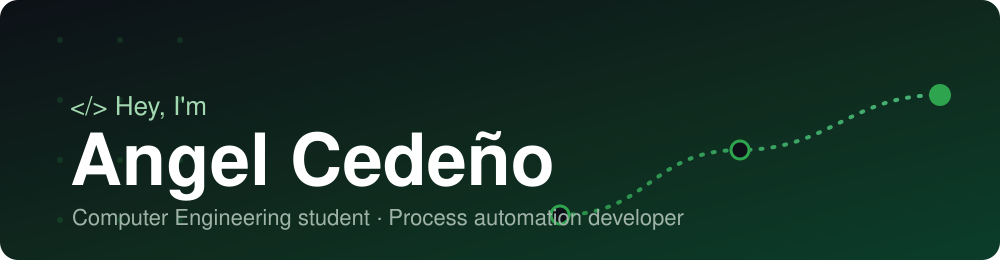

  

    <a href="#english">🇺🇸 English</a> | <a href="#español">🇪🇸 Español</a>
  

---

# English

  

 

## 👋 Hi there
 
I'm a Computer Engineering student from Ecuador and a developer passionate about finding order within the chaos of data. Currently, I am the **sole developer in charge of process automation** for my company's Fleet department, where I build custom tools to eliminate manual workloads and scale operational efficiency.

My work focuses on the intersection of software development and massive data analysis. Outside of production code, I tutor math and physics in English (GoStudent), design interactive prototypes, and prepare for innovation challenges like the NASA Space Apps Challenge.

---

## 💻 My toolbox

| Languages & Backend | Frontend & Web | Automation & DevOps | Databases & Tools |
|:---|:---|:---|:---|
|      |    |    |     |

---

## 🚀 Featured Projects

### 🏛️ [Communitly (ESPOL Communities)](https://github.com/GrupAP/Communitly)
> **Web platform to discover and manage student clubs and communities at ESPOL.**
* **Stack:** Python, Django, Flutter, SQLite, Docker.
* **My role:** Developed the activity management core (Create, Edit, and Delete events) and the validation logic behind community administration. 

### 🧭 [Atrapados en la ruta (DEVIO)](https://github.com/esegarra2006-arch/esegarra2006-arch.github.io)
> **Interactive simulation of a university transport app to mitigate bus chaos.**
* **Stack:** HTML5, CSS, GitHub Pages.
* **My role:** Second lead developer. Implemented the dynamic routing system, virtual balance payment options, and institutional email authentication.
* 🔗 [Live Demo](https://esegarra2006-arch.github.io/)

### 🤖 [Eco-Friendly Dispenser](https://github.com/ZAngelCR/DISPENSADOR)
> **Arduino-controlled hardware for dispensing pet food.**
* **Stack:** C++, Arduino, EEPROM.
* **My role:** Programmed the complete automation of the dispensing mechanism, integrating a servo motor and an MP3 module with a pre-recorded voice to attract pets.

---

## ⚡ Random Facts

* 🍕 My code compiles much better if there's a Domino's pepperoni pizza nearby.
* 🚗 Currently surviving driving lessons at Nova Driving School (license coming soon!).
* 🔐 Designed a 5-day birthday app with daily "logic locks" to surprise my partner.
---
---

# Español
## 👋 Hi there
 
Soy un estudiante de Ingeniería en Computación de Ecuador y un desarrollador apasionado por encontrar el orden dentro del caos de los datos. Actualmente soy el **único desarrollador a cargo de la automatización de procesos** para el departamento de Flotas de mi empresa, donde construyo herramientas a medida para eliminar tareas manuales y escalar la eficiencia operativa.

Mi trabajo se centra en el cruce entre el desarrollo de software y el análisis masivo de datos. Fuera del código de producción, doy tutorías de matemáticas y física en inglés (GoStudent), diseño prototipos interactivos y me preparo para retos de innovación como el NASA Space Apps Challenge.

---
## 💻 My toolbox

| Lenguajes & Backend | Frontend & Web | Automatización & DevOps | Bases de Datos & Herramientas |
|:---|:---|:---|:---|
|      |    |    |     |

---

## 🚀 Proyectos destacados

### 🏛️ [Communitly (ESPOL Communities)](https://github.com/GrupAP/Communitly)
> **Plataforma web para descubrir y gestionar clubes y comunidades estudiantiles de ESPOL.**
* **Stack:** Python, Django, Flutter, SQLite, Docker.
* **Mi aporte:** Desarrollé el núcleo de gestión de actividades (Crear, Editar y Eliminar eventos) y la lógica de validación detrás de la administración de comunidades. 

### 🧭 [Atrapados en la ruta (DEVIO)](https://github.com/esegarra2006-arch/esegarra2006-arch.github.io)
> **Simulación interactiva de una app de transporte universitario para mitigar el caos de los buses.**
* **Stack:** HTML5, CSS, GitHub Pages.
* **Mi aporte:** Segundo desarrollador al mando. Implementé el sistema de rutas dinámicas, opciones de pago con balance virtual y autenticación por correo institucional.
* 🔗 [Ver Demo Online](https://esegarra2006-arch.github.io/)

### 🤖 [Dispensador Ecológico Automatizado](https://github.com/ZAngelCR/DISPENSADOR)
> **Hardware controlado con Arduino para dispensar comida de mascotas.**
* **Stack:** C++, Arduino, EEPROM.
* **Mi aporte:** Programé la automatización total de la dispensación, integrando un servomotor y un módulo MP3 con una voz pregrabada para atraer a las mascotas.

---
## ⚡ Curiosidades

* 🍕 Mi código compila mucho mejor si hay una pizza de Domino's o una dona de Dunkin cerca.
* 🚗 Actualmente entendiendo las clases de manejo en Nova Driving School (pronto con licencia en los united).
* 🔐 Diseñé una app de cumpleaños de 5 días con "candados lógicos" de código diario para sorprender a mi pareja.
